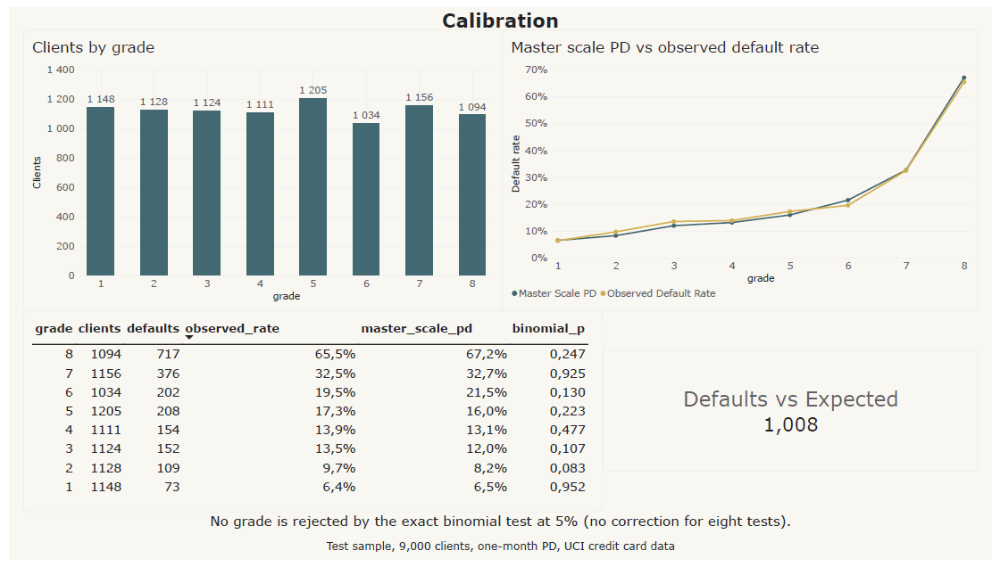
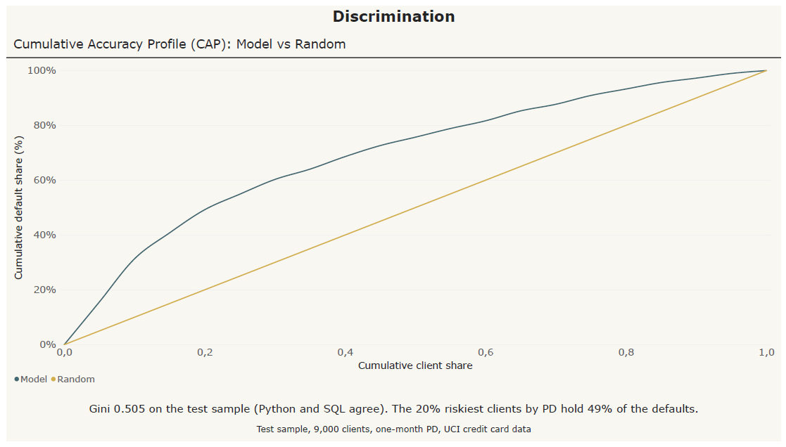

# PD model and portfolio report on open credit data

A probability-of-default scorecard with a rating-style report, built on the open UCI "Default of Credit Card Clients" data (30,000 clients, Taiwan, 2005; Yeh and Lien, 2009). The target is default in the following month, so this is a one-month PD on card data, not a 12-month bank PD. Research study on public data.

## Method
- Stratified 70/30 split; weight-of-evidence binning fitted on training data only.
- Logistic scorecard against gradient boosting as a challenger.
- Eight rating grades from training-score quantiles, with a master scale from training default rates.
- Out-of-sample binomial test per grade and a population stability index between train and test.
- Star-schema CSV tables and a build guide for a Power BI report (`powerbi/`), report queries in SQL and an Excel PD calculator (v0.2).

## Results (test sample, 9,000 clients)
| | Gini | AUC | KS |
|---|---|---|---|
| Logistic scorecard (WoE) | 0.505 | 0.753 | 0.391 |
| Gradient boosting | 0.547 | 0.773 | 0.415 |

- Training Gini of the scorecard is 0.535, so the out-of-sample drop is about 0.03.
- No grade is rejected by the binomial test at 5%, without a correction for multiple tests. Observed default rates rise from 6.4% in grade 1 to 65.5% in grade 8. Grades 3 and 4 have nearly the same master scale PD (12.0% and 13.1%), so the scale separates them weakly.
- Grade PSI between train and test is 0.001. Both samples come from the same period and split, so this is not evidence of stability over time.

## v0.2: SQL layer and an Excel calculator

The same results through the tools a credit risk team reports with, each checked against the Python model.

- **SQL (DuckDB), `sql/report_queries.sql`, `python run_sql.py`.** Six queries on the Power BI tables, written to `sql/output/`: grade summary with exposure shares and cumulative exposure (window functions), calibration z scores next to the exact binomial test, default rate by segment and age band against the rate of all segments in the band (the logic of the report's benchmark measure), a 20-band cumulative accuracy profile, the Gini coefficient as a Mann-Whitney statistic over distinct PD values, and the largest exposures. The SQL Gini is 0.5053, equal to the Python value. The 20% riskiest clients by PD hold 49% of the test defaults.
- **Excel, `excel/pd_calculator.xlsx`, `python build_excel.py`.** Formulas only, no macros: enter one client's seven characteristics and the sheet returns the bin and weight of evidence of each, scorecard points (20 points double the odds, 600 points at odds of 50:1), the PD, the grade and the master scale PD. A check sheet recomputes 25 test clients: recalculated in Excel, the largest difference from the Python PD is 1.4e-16 and all 25 grades match.
- **VBA, `excel/PortfolioTools.bas`.** A user-defined function for the two-sided exact binomial test (the same rule as `scipy.stats.binomtest`) and a macro that writes it next to the Python p-values on the master scale sheet. The test suite checks the rule line by line against SciPy. Run in Excel on the eight grades, the VBA p-values differ from the Python ones by less than 1e-15. The module is imported by hand (instructions in the file).
- **Power BI, `powerbi/credit_pd_report.pbix`, PDF export `powerbi/credit_pd_report.pdf`.** Four pages on a star schema (one fact table of 9,000 clients, grade and segment dimensions) with DAX measures: portfolio overview with segment and age slicers, calibration by grade with the binomial test, the cumulative accuracy profile and a default-rate benchmark by segment within each age band. Every number in the report matches the Python and SQL results. Build steps and measures: `powerbi/BUILD_REPORT.md`.





## Limits
One-month horizon, one portfolio and one period, random rather than out-of-time split, no LGD or EAD, no macro link. Payment status variables dominate (information value 0.89 for the latest status). The Excel calculator reproduces this one fitted scorecard and is not a production rating tool.

## Run
```
python -m venv .venv
.venv/Scripts/pip install -r requirements.txt
.venv/Scripts/python run_pd.py
.venv/Scripts/python run_sql.py
.venv/Scripts/python build_excel.py
.venv/Scripts/python -m pytest -q
```
